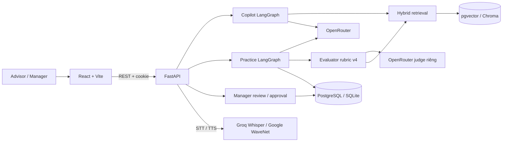

# P-043 — AI Sales Coach cho tư vấn viên VinFast

> Tóm tắt 1 câu: tư vấn viên mới tốn thời gian kèm cặp và dễ tư vấn sai → AI khách hàng để luyện tập, AI chấm điểm có dẫn chứng được quản lý duyệt, Copilot tra cứu có nguồn → cho tư vấn viên bán hàng VinFast và quản lý của họ.

**Live URL:** https://aisale.itup.io.vn/ (URL do nhóm cung cấp; cấu hình triển khai xem [hướng dẫn triển khai](docs/deployment.md)).

TODO (team): ảnh chụp màn hình Practice Room / Copilot / Manager.

Ảnh trong [báo cáo UI evidence](report/roleplay-supervisor-showcase-with-ui-evidence.html) được ghi rõ là prototype/UI concept; cần bổ sung ảnh ứng dụng hiện tại để đáp ứng mục screenshot.

## Vấn đề (Problem)

Đào tạo tư vấn viên bán hàng mới hiện gặp hai painpoint chính:

1. **Tốn nhân lực và thời gian của quản lý:** tư vấn viên mới thường cần quản lý kèm cặp trực tiếp trong lúc trò chuyện với khách. Mỗi người mới lại chiếm thêm thời gian của quản lý, nên chi phí đào tạo tăng theo số người được tuyển.
2. **Rủi ro tư vấn sai, mất khách:** khi không được hướng dẫn kịp thời, tư vấn viên dễ nói sai thông số xe, giá hay chính sách. Sai sót này làm giảm lòng tin của khách và khiến mất cơ hội bán hàng.

Bên cạnh đó, thông số xe, chính sách pin/sạc, giá và biểu phí thay đổi liên tục, nên tư vấn viên khó tra cứu nhanh và có nguồn khi đang tư vấn.

## Giải pháp (Solution)

Ứng dụng cung cấp một môi trường luyện tập riêng, nơi tư vấn viên luyện đi luyện lại các tình huống với khách hàng AI để nâng cao năng lực trước khi gặp khách thật, giảm rủi ro tư vấn sai (painpoint 2). Đồng thời, để giảm thời gian kèm cặp (painpoint 1), quản lý xem được lịch sử luyện tập role-play của từng tư vấn viên — transcript và bản đánh giá của mỗi buổi — vào bất cứ lúc nào thuận tiện, rồi đưa ra nhận xét có trọng tâm trong thời gian ngắn hơn nhiều.

MVP gồm **Copilot** tra cứu kiến thức xe/chính sách có trích nguồn và **Practice Room** trò chuyện nhiều lượt với AI Customer, nhận đánh giá có dẫn chứng từ transcript. Advisor xem lịch sử và bài được giao; manager giao kịch bản, xem hàng đợi, transcript, duyệt/sửa đánh giá và theo dõi năng lực đội ngũ từ các bài đã duyệt. Đây là sản phẩm học tập dùng corpus công khai và khách hàng giả lập, không phải kênh công bố chính sách chính thức của VinFast.

- **Copilot:** trả lời có trích nguồn từ corpus công khai, từ chối khi thiếu bằng chứng.
- **Practice Room:** tư vấn viên mở lời trước, AI Customer phản hồi nhiều lượt (chat chữ hoặc giọng nói), AI judge riêng chấm theo rubric kèm evidence.
- **Manager console:** giao bài, duyệt/sửa đánh giá, xem năng lực đội.

## Target User

- Primary: **Tư vấn viên bán hàng VinFast (Advisor)**, nhất là người mới: luyện tình huống với khách hàng AI, tra cứu thông số/chính sách có nguồn khi tư vấn.
- Secondary: **Quản lý bán hàng (Manager)**: giao bài luyện tập, xem transcript và duyệt/sửa đánh giá thay vì kèm cặp trực tiếp từng buổi, theo dõi năng lực đội.

## Tech Stack

| Layer | Technology |
|-------|-----------|
| AI Agent | LangGraph + OpenRouter (chat, embedding, judge riêng) |
| Backend | FastAPI + Python 3.11 |
| Frontend | React 19 + Vite 8 |
| Database | PostgreSQL + pgvector / SQLite + Chroma |
| DevOps | Docker Compose + GitHub Actions; Render, Vercel, Neon |

- **Frontend:** React 19, Vite 8 (Caddy khi chạy Docker, Vercel khi hosted).
- **Backend:** Python 3.11, FastAPI, LangGraph/LangChain, SQLAlchemy.
- **AI:** OpenRouter (chat và embedding), hybrid retrieval (vector + BM25), LangSmith tùy chọn; giọng nói dùng Groq Whisper và Google WaveNet.
- **Dữ liệu:** PostgreSQL + pgvector (Docker/hosted) hoặc SQLite + Chroma (chạy trực tiếp).
- **Triển khai:** Docker Compose; Render (backend) và Vercel (frontend).

Kiến trúc chi tiết: [ARCHITECTURE.md](ARCHITECTURE.md) và [sơ đồ kiến trúc](docs/architecture_diagram.md).



## Quick Start (Setup)

### Chạy local

Sau khi tạo `.env` và điền các biến ở phần dưới, chọn chạy Python trực tiếp hoặc Docker. Mỗi máy có database riêng; muốn chia sẻ dữ liệu cần backend và PostgreSQL hosted dùng chung.

Mô hình triển khai được mô tả là Render cho backend, Vercel cho frontend và Neon cho PostgreSQL + pgvector; xem [hướng dẫn triển khai](docs/deployment.md). Mô tả tính năng trong README phản ánh mã trên nhánh hiện tại; không khẳng định các thay đổi chưa merge đã có trên bản live. URL ở đầu README không xác nhận trạng thái backend hoặc uptime. Chỉ mở PR vào `develop` sau khi kiểm tra deployment thật.

Cần Python 3.11, Node.js 22 tương thích Vite 8 (Docker dùng Node 22), npm và OpenRouter API key có quyền gọi chat/embedding. Lời gọi thật có thể phát sinh phí.

```bash
python3.11 -m venv .venv
source .venv/bin/activate
python -m pip install -r requirements.lock
cp .env.example .env
```

Điền `OPENROUTER_API_KEY` trong `.env`; không commit key, mật khẩu hoặc database local. Tên biến cần biết (không ghi giá trị credential vào tài liệu):

| Nhóm | Biến môi trường |
| --- | --- |
| Sinh hội thoại / embedding | `LLM_PROVIDER`, `OPENROUTER_API_KEY`, `OPENROUTER_MODEL_NAME`, `EMBEDDING_PROVIDER`, `EMBEDDING_MODEL_NAME` |
| Judge độc lập | `PRACTICE_JUDGE_PROVIDER`, `PRACTICE_JUDGE_MODEL` |
| Persistence | `DATABASE_URL`, `VECTOR_STORE_TYPE`, `CHROMA_PERSIST_DIR`, `CHROMA_COLLECTION_NAME` |
| Web / phiên | `APP_ENV`, `CORS_ORIGINS`, `AUTH_COOKIE_SECURE`, `AUTH_SESSION_TTL_HOURS` |
| Tài khoản local | `DEMO_ADVISOR_PASSWORD`, `DEMO_MANAGER_PASSWORD` |
| Bootstrap production | `BOOTSTRAP_MANAGER_USERNAME`, `BOOTSTRAP_MANAGER_DISPLAY_NAME`, `BOOTSTRAP_MANAGER_PASSWORD` |
| Voice tùy chọn | `GROQ_API_KEY`, `GOOGLE_TTS_SERVICE_ACCOUNT_JSON` |
| Trace tùy chọn | `LANGSMITH_TRACING`, `LANGSMITH_API_KEY`, `LANGSMITH_PROJECT`, `LANGSMITH_CAPTURE_CONTENT` |
| Trace Roleplay/Practice (tài khoản riêng) | `ROLEPLAY_LANGSMITH_TRACING`, `ROLEPLAY_LANGSMITH_API_KEY`, `ROLEPLAY_LANGSMITH_ENDPOINT`, `ROLEPLAY_LANGSMITH_PROJECT`, `ROLEPLAY_LANGSMITH_CAPTURE_CONTENT` |
| Docker / hosted frontend | `POSTGRES_USER`, `POSTGRES_PASSWORD`, `POSTGRES_DB`, `FRONTEND_PORT`, `RENDER_BACKEND_URL` |

Theo [cấu hình Python](src/config.py), generator mặc định là `openai/gpt-6-luna`, embedding là `openai/text-embedding-3-small` qua OpenRouter. Judge mặc định dùng provider OpenRouter và model `deepseek/deepseek-v3.2`, temperature 0; runtime không cho judge trùng cả provider lẫn model với generator. Chạy trực tiếp mặc định SQLite ở `data/app.db` và Chroma ở `data/chroma`. Đổi embedding model cần reindex phù hợp. Xem [.env.example](.env.example) và [hướng dẫn database](docs/database-backends.md).

Trong `.env`, đặt `DEMO_ADVISOR_PASSWORD` và `DEMO_MANAGER_PASSWORD` riêng, rồi seed tài khoản local:

```bash
python -m scripts.seed_demo_users
```

Đăng nhập bằng `advisor.demo` và `manager.demo`. Seed script cập nhật hai tài khoản demo cố định khi chạy lại; không dùng với tài khoản thật. Trong mã hiện tại, manager có thể tạo tài khoản Advisor trong tab **Tài khoản**; môi trường production dùng bootstrap manager và bắt buộc đổi mật khẩu khởi tạo.

### Tài khoản demo và dữ liệu mẫu

Để dashboard quản lý và Phòng luyện tập có dữ liệu khi demo, seed dữ liệu mẫu (sau khi đã chạy `seed_demo_users` ở trên):

```bash
python scripts/seed_practice_showcase.py          # xem trước, không ghi
python scripts/seed_practice_showcase.py --apply  # ghi vào database của DATABASE_URL
```

Script tạo khoảng 80 lượt luyện tập hoàn thành trong 6 tuần cho 4 tình huống thật trong `data/scenarios/scenarios.json`, kèm hội thoại chữ tiếng Việt, bản chấm AI nháp, các lượt duyệt của `manager.demo` (một số có điều chỉnh điểm kèm lý do và nhận xét chung), khoảng 10 bài được giao (2 bài quá hạn) và 4 việc cần làm. `advisor.demo` đổi tên hiển thị thành "Phạm Đình Duy" và `manager.demo` thành "Nguyễn Thu Trang" nếu vẫn đang dùng tên mặc định, và có thêm 7 tư vấn viên giả (id bắt đầu bằng `showcase1_`) chỉ là dữ liệu, không có mật khẩu đăng nhập được in ra. Id cố định nên chạy lại `--apply` không tạo thêm dòng; thời gian được tính theo giờ Asia/Ho_Chi_Minh tại lần chèn đầu tiên.

Toàn bộ dữ liệu này là **hư cấu**, không chứa thông tin cá nhân, và **không bao giờ** được dùng làm bằng chứng đánh giá (evaluation) hay chất lượng mô hình. Script không chặn production, nên hãy kiểm tra `DATABASE_URL` trước khi `--apply`.

Chạy hai terminal từ thư mục gốc repo:

```bash
source .venv/bin/activate
uvicorn src.main:app --reload --port 8000
```

```bash
cd frontend
npm ci
npm run dev
```

Mở <http://localhost:3000>. Vite proxy `/api` và `/health` sang cổng 8000; Swagger ở <http://localhost:8000/docs>. Lần khởi động đầu ingest corpus nếu Chroma rỗng. `/health` trả 200 **không chứng minh** Copilot/provider hoạt động; cần gửi câu hỏi thật. Nếu không dùng Vite proxy, cấu hình `CORS_ORIGINS` tương ứng frontend origin.

### Chạy Docker

```bash
docker compose up --build -d
docker compose exec backend python -m scripts.seed_demo_users
```

[docker-compose.yml](docker-compose.yml) chạy Caddy + React, FastAPI và PostgreSQL + pgvector; mở <http://localhost:3000>. Volume `postgres_data` giữ SQL và vector, `index_manifests` giữ manifest. Compose chỉ publish cổng frontend; Swagger qua proxy ở <http://localhost:3000/docs> **không được cấu hình**. Để xem Swagger, dùng cách chạy local cổng 8000 ở trên hoặc thêm port mapping backend trong cấu hình riêng.

Lưu ý cấu hình hiện tại: Compose đặt mặc định generator là `google/gemini-2.0-flash-001`, khác mặc định Python; đặt `OPENROUTER_MODEL_NAME` trong `.env` để chọn rõ model. Compose chưa chuyển tiếp `PRACTICE_JUDGE_PROVIDER` và `PRACTICE_JUDGE_MODEL`: judge trong container dùng mặc định Python. Muốn đổi judge, bổ sung hai tên biến vào `backend.environment` trong cấu hình Compose riêng. Không chỉ sửa `.env` rồi cho rằng container đã nhận chúng.

### Luồng demo và câu hỏi mẫu

Practice Room hỗ trợ push-to-talk: giữ micro tối đa 90 giây, thả để Groq Whisper chép tiếng Việt. Công tắc **Tự động gửi** quyết định gửi ngay bản chép hay sửa trước khi nhấn Gửi; phản hồi AI Customer có thể được đọc bằng Google WaveNet. Hộp nhập chữ vẫn hiện trong cả hai chế độ. Xem [cấu hình Voice Mode](docs/voice-mode.md); chat chữ vẫn chạy khi chưa có key giọng nói.

Bốn kịch bản hiện có trong [scenarios.json](data/scenarios/scenarios.json):

| ID | Nội dung |
| --- | --- |
| `SCENARIO_01_VF5_TAXI` | Khách chạy dịch vụ cân nhắc VF 5 Plus |
| `SCENARIO_02_VF7_VS_CX5` | Gia đình so sánh VF 7 Plus với Mazda CX-5 |
| `SCENARIO_03_VF6_APARTMENT` | Gia đình ở chung cư lo hạ tầng sạc cho VF 6 |
| `SCENARIO_04_VF6_ECO_PLUS_UPSELL` | Chị Hà cân nhắc VF 6 Eco hay nâng lên Plus |

Kịch bản 04 chấp nhận cả `close_eco` và `upsell_plus`; upsell là kết quả ưu tiên, không phải kết quả duy nhất hợp lệ. Evaluator chung đọc cấu hình từng scenario và `policy_expectations`, dùng `sales-rubric-v4` với 5 tiêu chí: khám phá nhu cầu, kiến thức sản phẩm, xử lý phản đối, chính xác chính sách, chốt / bước tiếp theo. Tiêu chí được đánh giá có điểm 1–3 và quote/message ID từ transcript; thiếu cơ hội/bằng chứng có thể là `unassessed`, không tự gán điểm. Xem [evaluator](src/agents/roleplay/evaluator.py) và [prompt rubric](src/agents/roleplay/prompts/evaluator.py).

Guardrail hai lớp gồm [lọc cục bộ](src/agents/roleplay/guardrails.py) trước lời gọi model và cờ `unsafe_or_abusive` của analyzer. Vi phạm dẫn tới `advisor_misconduct`, dừng hội thoại; evaluator ép điểm đã chấm về 1. Lỗi Practice có mã ổn định và thông báo tiếng Việt từ [practice_errors.py](src/api/practice_errors.py), được UI ánh xạ thành notice dialog với hành động phù hợp như thử lại hoặc đăng nhập.

1. Đăng nhập Advisor. Hỏi Copilot: **“Giá niêm yết VF 8 Thế hệ mới theo bảng giá VinFast là bao nhiêu?”** Mở citation. Câu ngoài kho: **“Giá bảo hiểm chính xác của đại lý X ngày mai là bao nhiêu?”** phải không tự bịa.
2. Vào Practice Room, chọn **VF 5 Plus — khách chạy dịch vụ**. Tư vấn viên mở lời chào khách trước; khách phản hồi theo nhu cầu của kịch bản. Hỏi quãng đường/ngày, tiền xăng Vios thực tế và giờ nghỉ/sạc; xử lý lo ngại chi phí, tránh cam kết tiết kiệm khi chưa đủ dữ liệu. Kết thúc để xem điểm AI dự thảo, transcript evidence và lịch sử.
3. Đăng xuất, đăng nhập Manager. Vào **Giao bài**, chọn Advisor và kịch bản rồi đặt hạn. Đăng nhập lại Advisor, bắt đầu bài trong Practice Room và hoàn thành phiên. Đăng nhập Manager để thấy trạng thái hoàn thành.
4. Manager xem hàng đợi và transcript, nhập lý do khi duyệt; vào **Năng lực** để xem điểm kỹ năng từ các phiên đã duyệt. Advisor chưa có ít nhất 3 phiên được duyệt và có điểm sẽ chưa được xếp hạng.

Bài được giao chỉ hoàn thành khi một phiên Practice bắt đầu từ chính bài đó được đánh giá thành công. Một phiên tự luyện cùng kịch bản không tự hoàn thành bài được giao. Dữ liệu bài tập và điểm đội ngũ lưu trong database; không có hồ sơ hoặc điểm giả trên màn hình.

Không biến giá niêm yết thành “giá lăn bánh” hay tự suy ra mọi VF 5 phải thuê pin. Nếu provider lỗi, UI cần cho retry; không mô tả sai là “không có tài liệu”.

### Giám sát Copilot

Xem [workflow Copilot: từng node, state và prompt](docs/copilot-workflow.md) để theo dõi luồng hiện tại.

Copilot dùng Structured Outputs cho phân tích, lập kế hoạch, sinh câu trả lời và kiểm tra từng phát biểu; code xác định độ bao phủ requirement và gắn citation trước khi công bố.

Workflow `v9-evidence-review` mặc định dùng Jev qua OpenRouter để chọn evidence (`COPILOT_EVIDENCE_SELECTION_STRATEGY=jev_context`); có fallback RRF khi Jev lỗi và log quyết định từng cụm nguồn.

Kết quả đánh giá Copilot ngày 18/10/2026 (**44/50 Pass = 88.0%**) được lưu tại [eval/reports/copilot_benchmark_live_2026-10-18.md](eval/reports/copilot_benchmark_live_2026-10-18.md) (cùng `summary.json`, `reviews.json`, `results.json` trong `eval/reports/`) và trên LangSmith (`copilot-benchmark-20261018`); các file trace trung gian `.nodes.json` giữ local tại `eval/results/copilot-benchmark-20261018/`. Xem [tài liệu workflow & Sales Copilot](docs/copilot-workflow.md) để đọc chi tiết kiến trúc và kết quả đánh giá.

Dùng `.venv` làm môi trường Python chính. Dependency trực tiếp nằm trong `requirements.txt`; local, CI và Docker cài phiên bản chính xác từ `requirements.lock`. CI cấu hình Python 3.11. Cấu hình LangSmith qua các biến `LANGSMITH_*` trong `.env.example`; mỗi request Copilot có `X-Request-ID` để tìm log và trace.

### Kiến trúc, kiểm thử và bằng chứng

Xem [sơ đồ kiến trúc](docs/architecture_diagram.md) và [hướng dẫn Database](docs/database-backends.md). React/Vite gọi FastAPI bằng cookie phiên; Copilot dùng LangGraph, hybrid retrieval, vector index và OpenRouter. Practice dùng LangGraph giữ trạng thái, AI Customer, evaluator rubric có evidence và manager HITL. Docker dùng PostgreSQL + pgvector local; chạy Python trực tiếp mặc định SQLite + Chroma (hoặc PostgreSQL hosted khi cấu hình `DATABASE_URL`). Dữ liệu trên ổ local **không tự bền vững** khi deploy lên filesystem tạm.

```bash
ruff check src tests
ruff format --check src tests
pytest tests -q
cd frontend && npm run lint && npm run build
```

Workflow [CI](.github/workflows/ci.yml) chạy Ruff và pytest backend trên push/PR vào `main`/`develop`; lint/build frontend và kiểm tra format ở trên là kiểm tra riêng, chưa nằm trong workflow này.

Kiểm thử phần mềm khác đánh giá AI. [Báo cáo Gate 2](eval/results/gate2_manual_cases_2026-10-04.md) ghi 5 ca thủ công với input, output quan sát, expected và giới hạn. [Benchmark Copilot 50 case](eval/datasets/copilot_benchmark.json) là tập rộng hơn, **không tự chứng minh 50 lời gọi thật đã chạy**. Các smoke trước nằm trong `eval/results/`. Trạng thái GitHub Actions phải xem trên PR; job không bắt đầu không phải CI pass.

Feature branch → PR `develop` → kiểm tra/review → PR `develop` → `main` khi đủ điều kiện. Không push trực tiếp vào `main`. [Kịch bản video Gate 2](presentation/GATE2_DEMO.md) mô tả 3 phút cần quay. AI usage log, Git worklog và eval evidence là các bằng chứng riêng; không trộn với file chứa key.

## Project Structure (Cấu trúc thư mục)

```text
.
├── src/                 # FastAPI, agents, services, integrations, knowledge
├── frontend/            # React/Vite, API client, giao diện Advisor/Manager
├── data/                # Scenario JSON, corpus và dữ liệu local
├── tests/               # Kiểm thử backend
├── eval/                # Dataset và kết quả đánh giá AI
├── docs/                # Đặc tả, triển khai, database, voice
├── scripts/             # Seed và tiện ích vận hành
├── report/              # Bằng chứng / báo cáo demo
├── presentation/        # Kịch bản trình diễn
├── .github/workflows/   # CI
├── Dockerfile
├── docker-compose.yml
└── ARCHITECTURE.md
```

## API Endpoints

Base path `/api/v1` (trừ `/health`, `/ready`). Đăng nhập tạo cookie phiên; các endpoint Practice/Manager yêu cầu đăng nhập, endpoint Manager yêu cầu vai trò `manager`. Tài liệu đầy đủ (request/response schema) ở Swagger `/docs` khi chạy backend. Lỗi Practice trả `{detail, code}` tiếng Việt.

| Method | Path | Description | Request chính |
| --- | --- | --- | --- |
| GET | `/health`, `/ready` | Kiểm tra sống / sẵn sàng | — |
| POST | `/auth/login` | Đăng nhập | `{username, password}` |
| GET | `/auth/me` | Người dùng hiện tại | — |
| POST | `/auth/logout`, `/auth/change-password` | Đăng xuất, đổi mật khẩu | — / mật khẩu cũ và mới |
| POST | `/auth/advisors` | Manager tạo tài khoản Advisor | thông tin tài khoản |
| POST | `/copilot/query`, `/copilot/query/stream` | Hỏi Copilot (trả lời có trích nguồn; bản stream) | `{query, target_date?, session_id?, customer_context?, domain?}` |
| GET / DELETE | `/copilot/sessions`, `/copilot/sessions/{session_id}` | Lịch sử hội thoại Copilot | — |
| GET | `/copilot/sources/{document_id}` | Xem tài liệu nguồn được trích | — |
| GET | `/practice/scenarios` | Danh sách kịch bản | — |
| POST | `/practice/sessions` | Bắt đầu phiên luyện tập | `{scenario_id, max_turns?, assignment_id?}` |
| POST | `/practice/{session_id}/message` | Gửi lượt của Advisor, nhận phản hồi khách AI | `{message}` |
| POST | `/practice/{session_id}/retry-reply` | Thử lại phản hồi khách khi provider lỗi | — |
| POST | `/practice/{session_id}/voice/transcribe`, `/practice/{session_id}/voice/speech` | Chuyển giọng nói thành chữ / đọc phản hồi khách | file ghi âm / văn bản |
| POST | `/practice/{session_id}/finish` | Kết thúc phiên và chấm điểm | — |
| GET | `/practice/{session_id}`, `/practice/{session_id}/result`, `/practice/{session_id}/attempt` | Trạng thái phiên, kết quả, chi tiết attempt | — |
| GET | `/practice/assignments`, `/practice/history` | Bài được giao, lịch sử luyện tập của Advisor | `?scenario_id=` (history) |
| GET | `/manager/reviews`, `/manager/reviews/{session_id}` | Hàng đợi duyệt, chi tiết phiên | — |
| PATCH | `/manager/reviews/{session_id}` | Duyệt / sửa đánh giá (HITL) | `{score_overrides?, recommended_next_practice?, change_reason}` |
| GET | `/manager/reviews/{session_id}/voice/usage` | Thống kê dùng giọng nói của phiên | — |
| GET | `/manager/attempts`, `/manager/overview`, `/manager/advisors` | Danh sách phiên, tổng quan đội, năng lực Advisor | — |
| GET / POST | `/manager/assignments` | Xem / giao bài luyện tập | `{advisor_id, scenario_id, title, due_date?}` |

## Deliverables Checklist

- [x] Source Code (GitHub)
- [x] README.md
- [x] Architecture Diagram ([docs/architecture_diagram.md](docs/architecture_diagram.md), [ARCHITECTURE.md](ARCHITECTURE.md))
- [x] AI Logs (tự động thu thập qua hook, `.ai-log/`)
- [x] Live URL / Deploy: https://aisale.itup.io.vn/
- [ ] Video Demo — TODO (team)
- [ ] Pitch Deck (`presentation/`) — TODO (team)
- [x] Weekly Journal ([JOURNAL.md](JOURNAL.md))
- [x] Worklog ([WORKLOG.md](WORKLOG.md))
- [x] Evaluation Evidence ([eval/results/](eval/results/)) — TODO (team): bổ sung phản hồi người dùng thật và cập nhật báo cáo

## Team

MSSV theo [WORKLOG.md](WORKLOG.md); phạm vi công việc theo [phân công nhóm](docs/project-management/Task_division.md).

| Thành viên        | MSSV        | Phạm vi phụ trách được ghi trong repo                                       |
| ----------------- | ----------- | --------------------------------------------------------------------------- |
| Phạm Đình Duy     | 2A202602913 | Leader; AI Customer, scenario runtime, Practice backend, coaching/evaluator |
| Phạm Quốc Đạt     | 2A202602384 | Data, evaluation, benchmark, calibration                                    |
| Võ Trường An      | 2A202602656 | Frontend, UX, tích hợp API phía client, hosting.                            |
| Nguyễn Hữu Chương | 2A202602601 | Copilot, shared backend, RAG, persistence/runtime                           |

### Trách nhiệm khi AI sai

**Khi điểm AI chấm sai, người chịu trách nhiệm cho điểm cuối cùng là manager đã duyệt phiên đó, vì điểm AI chỉ là bản nháp và chỉ điểm đã được manager duyệt mới được dùng để đánh giá năng lực; Phạm Đình Duy chịu trách nhiệm sửa evaluator khi lỗi lặp lại.**

| Loại lỗi | Chịu trách nhiệm | Phát hiện | Truy vết | Xử lý |
| --- | --- | --- | --- | --- |
| Điểm/nhận xét AI chấm sai (bản nháp) | Phạm Đình Duy (evaluator); Phạm Quốc Đạt (calibration) | Manager review từng phiên; code kiểm tra message ID và trích dẫn nguyên văn; bộ calibration JC1–JC6 | `ai_draft_json`, `judge_model`, transcript theo `session_id` | Manager sửa điểm kèm lý do; Duy chỉnh prompt/rubric; Đạt chạy lại calibration |
| Điểm đã duyệt dùng cho năng lực/xếp hạng | Manager duyệt phiên (HITL) | Advisor xem kết quả đã duyệt; lịch sử review của manager | `practice_manager_reviews`: `manager_id`, `reviewed_at`, `change_reason`, `approved_result_json` | Manager duyệt lại; nhóm sửa luồng review nếu lỗi do hệ thống |
| Giá/khuyến mãi/chính sách sai hoặc hết hạn trong chấm điểm | Phạm Quốc Đạt (dữ liệu corpus); Phạm Đình Duy (resolver kịch bản) | `scripts/check_scenario_knowledge.py` và test độ phủ theo ngày hiện tại | `current_policy_evidence`: document ID, version, trích dẫn | Đạt cập nhật corpus; Duy cập nhật lookup kịch bản |
| Copilot trả lời sai hoặc trích nguồn sai | Nguyễn Hữu Chương (Copilot, RAG); Phạm Quốc Đạt (benchmark) | Kiểm tra citation trong Copilot; benchmark Copilot | `X-Request-ID`, LangSmith trace khi bật | Chương sửa retrieval/prompt; Đạt cập nhật bộ câu hỏi đánh giá |
| AI Customer lộ thông tin ẩn hoặc nói sai vai; Advisor có hành vi sai phạm | Phạm Đình Duy (AI Customer, guardrail) | Guardrail hai lớp, chặn lộ giá phía khách | Transcript và checkpoint theo `session_id` | Phiên kết thúc với `advisor_misconduct`; Duy sửa persona/guardrail |
| Giao diện hiển thị sai điểm hoặc trạng thái | Võ Trường An (frontend) | Manager/Advisor báo lỗi; test frontend | `session_id` và phản hồi API của phiên | An sửa giao diện |

Người phụ trách từng dòng đã được nhóm xác nhận; cả nhóm được thông báo khi có sự cố. TODO (team): ghi kênh báo sự cố.

## License

[MIT](LICENSE) — dùng tự do cho mục đích giáo dục.
