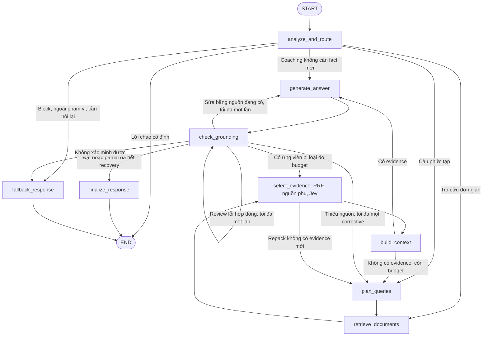
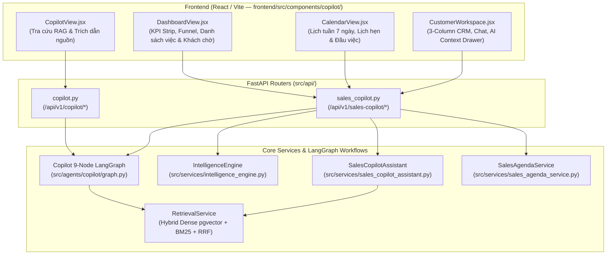

# Workflow tra cứu Copilot & Kiến trúc Sales Copilot Workspace

## 1. Luồng chạy

Ngoài các cạnh chính trong hình, khi hết budget, wrapper `observed` chuyển sang
`finalize_response` nếu đã có snapshot xác minh, còn không chuyển `fallback_response`.
Lỗi dependency không được biến thành kết luận “tài liệu không có”: service trả lỗi khả dụng.

Đầu HTTP có admission/concurrency, deadline, quyền sở hữu session, history và exact cache.
Cache hit hợp lệ có thể trả ngay mà không chạy graph. Sau graph, service lưu phiên;
SSE chỉ phát nội dung đã kiểm tra và lưu xong, không stream draft trực tiếp.

## 2. Từng node

### `analyze_and_route` — guard, hiểu câu hỏi, chọn nhánh

Code: [guard.py](../src/agents/copilot/nodes/guard.py).

- Lời chào/thanks/help phải khớp toàn bộ câu sau chuẩn hóa mới dùng câu trả lời cố định.
  “Hi, giá VF 5?” vẫn chạy phân tích.
- Cắt history tối đa tám tin, tổng 12.000 ký tự. Giải ngày lookup bằng `resolve_date`;
  ngày mua/hóa đơn là dữ kiện điều kiện, không tự đổi thành ngày tra cứu.
- Gọi `INTAKE_PROMPT`, nhận `IntakeDecision`. Pydantic kiểm tra schema; code kiểm tra
  mẫu xe và filters với catalog, phạm vi requirement và budget search. Schema native dùng giới hạn requirements theo request, không chỉ ghi trong prompt.
- Tạo requirement fact/advice/external, phân loại factual/mixed/coaching. Coaching thiếu goal được thêm chính query làm advice goal.
- Code nâng simple thành complex khi có nhiều fact, nhiều mẫu hoặc comparison.
  Nếu vẫn có fact tra cứu được, thiếu nhu cầu khách/dữ liệu đại lý không chặn toàn bộ câu hỏi.
- Simple tạo sẵn một `SearchPlan`, bỏ qua planner. Coaching không cần fact bỏ qua retrieval.
  Block/out_of_scope/clarify chuyển fallback. Ngày không nhất quán tạo câu hỏi làm rõ.

### `plan_queries` — lập kế hoạch tìm nguồn

Code: [planning.py](../src/agents/copilot/nodes/planning.py).

Chỉ chạy cho complex hoặc corrective. Nhận query, analysis, catalog, ngày, ngữ cảnh khách,
search signatures, feedback và requirements cần phục hồi. `PLAN_PROMPT` tạo `SearchPlan`.
Mỗi search có query, filters và danh sách requirement được phục vụ. Native JSON Schema áp
`maxItems` bằng số query còn được phép và enum requirement IDs; validator vẫn kiểm tra
phủ đủ mục tiêu và filter hợp lệ. Planner tránh query thông số quá rộng nhiều mẫu khi có thể tách.

Code từ chối query trùng, ID lạ, filter ngoài corpus, mẫu xe không có căn cứ từ input,
kế hoạch vượt budget hoặc bỏ sót factual requirement mục tiêu. Corrective chỉ được tìm
`recovery_requirement_ids`. Nếu model xuất kế hoạch không hợp lệ, code dựng kế hoạch từ
requirements đã duyệt: nhóm theo mẫu, phân vào số query còn lại, giữ đủ ID, không thêm
filter loại nguồn quá hẹp. Kế hoạch dự phòng vẫn qua cùng validator; không gọi lại planner.
Nếu không dựng được kế hoạch hợp lệ thì dùng snapshot cũ hoặc fallback.

### `retrieve_documents` — dense và BM25 song song

Code: [retrieval.py](../src/agents/copilot/nodes/retrieval.py),
[tools.py](../src/agents/copilot/tools.py).

Kiểm tra index một lần, lưu `snapshot` đã xác minh. Mỗi planned query chạy đồng thời
dense và BM25 với `product_model`, `document_type`, `policy_type` và ngày tra cứu.
Cả hai nhánh đều lọc metadata/ngày; với filter mẫu xe, nguồn chung `ALL` có thể được giữ
trừ khi tìm riêng `product_specs`.

Một nhánh lỗi thì giữ nhánh còn lại và tăng `retrieval_errors`. Cả hai lỗi thì báo dependency.
Nhiều queries trong plan cũng chạy đồng thời. `tool_calls` tính **một planned query**,
không tính dense và BM25 thành hai query. Nguồn phụ/Jev không cộng vào số search này.

Output là `raw_search_results`, số rounds/calls, signatures và errors. Đã bỏ chế độ
retrieval `read_context`: phụ thuộc nguồn được chuẩn bị ngay trong selector.

### `select_evidence` — fusion, chuẩn bị bundle, Jev, áp ngân sách

Code: [evidence.py](../src/agents/copilot/nodes/evidence.py),
[source_context.py](../src/knowledge/source_context.py), [jev.py](../src/agents/copilot/jev.py).

1. RRF ghép dense/BM25 theo `sum(1 / (60 + rank))`, không cộng trực tiếp hai loại điểm.
2. Xen kẽ kết quả các query để một query không chiếm hết pool. Khi corrective, đưa nguồn mới
   nhắm phần thiếu và ứng viên từng bị loại vào pool; xen kẽ anchor cũ còn cần với hits mới
   để không mất toàn bộ dữ kiện đã biết trước khi chấm. Không ghim bộ nguồn cũ vào kết quả chọn.
3. Kiểm tra ngày, phạm vi mẫu xe, ID, content và metadata khớp snapshot. Registry cấp citation ID
   ổn định trong request; chunk cũ giữ ID, nguồn phụ mới được cấp ID tiếp theo.
4. Chuẩn bị **toàn bộ pool**: row có prefix đủ nghĩa dùng prefix; policy giữ section/điều kiện;
   bảng tách giữ header. Giữ scope chung, không nhập ngoại lệ của nhóm khách khác.
   Đọc theo snapshot trong một batch cục bộ, tối đa 10 giây và giữ lại 45 giây runtime.
   Thiếu phụ thuộc bắt buộc thì loại bundle bằng `context_unavailable`.
5. Jev chuẩn hóa thứ tự nguồn và gộp bundle giống hệt. Một bundle duy nhất chỉ gọi API một lần;
   bundle chồng lặp một phần vẫn chấm riêng. Cache quyết định chỉ trong request.
6. Jev hỏi relevance, có evidence sử dụng được, bác bỏ tiền đề, injection; mỗi fact có hai điểm:
   `supports_R#` (đóng góp/điều kiện) và `answers_R#` (trực tiếp đủ dữ kiện cho riêng mục tiêu).
   Đây là điểm model trong `[0,1]`, chưa hiệu chỉnh thành xác suất đúng trên corpus này;
   không phải chứng minh câu trả lời đã đúng.
7. Code áp ngưỡng: injection loại cả cụm và các bundle chứa chung chunk đó; nguồn bác bỏ tiền đề
   được giữ nhãn riêng. Lỗi API/timeout trả `unscored`; RRF là thứ tự dự phòng.
   Một bundle lỗi không khôi phục các bundle đã bị Jev loại thành công.
8. Chọn theo lợi ích tăng thêm/chi phí token tăng thêm: điểm trực tiếp và điểm đóng góp
   liên tục, điểm nguồn bổ trợ có lợi ích giảm dần; không đánh dấu requirement đã hoàn thành.
   Sau greedy có tối đa hai lượt hoán đổi 1–2 bundle, giới hạn 8 nguồn bỏ/12 nguồn thêm mỗi lượt.
   Shared dependencies chỉ tốn chỗ một lần. Giữ nguyên bundle bắt buộc, không cắt facts/điều kiện.

`rrf_context` vẫn tồn tại để đối chứng/fallback vận hành. Nó dùng cùng chuẩn bị bundle
và giới hạn context, chỉ bỏ bước chấm Jev. Nhánh keyword `legacy` đã bị xóa.

### `build_context` — đóng gói, không chấm lại evidence

Code: [evidence.py](../src/agents/copilot/nodes/evidence.py),
[context.py](../src/agents/copilot/context.py).

Có nguồn: loại trùng chunk, giữ citation/metadata/nội dung đầy đủ, thêm nhãn bác bỏ tiền đề,
kiểm tra ngân sách token ước lượng cùng trần block/ký tự và chuyển generate. Không gọi model, không đọc lại overflow.
Nếu state đã chọn quá budget, báo lỗi thay vì cắt facts âm thầm.

Không có nguồn: yêu cầu tối đa một corrective nếu đủ ngân sách; ưu tiên repack khi đã có ứng viên bị loại do budget. Hết recovery thì
dùng snapshot đã xác minh nếu có; không có snapshot thì fallback.

Không ép search chỉ vì từng bundle chưa đủ hỗ trợ mọi requirement: hai bảng giá có thể
kết hợp để tính chênh lệch. Checker sau generate mới đánh giá được điều đó.

### `generate_answer` — sinh claims có cấu trúc, render bằng code

Code: [answer.py](../src/agents/copilot/nodes/answer.py),
[structured.py](../src/agents/copilot/validation/structured.py).

`GENERATE_PROMPT` nhận query, requirements, sources, ngày, sáu tin history gần nhất,
ngữ cảnh khách, draft/feedback cũ. Output `GeneratedAnswer` chỉ còn:
`claims`, `suggested_message`, `suggested_next_question`.

Mỗi claim có text Markdown, kind fact/advice/limitation, requirement IDs và citation IDs.
Validator kiểm tra ID thuộc state, fact liên kết requirement factual và đúng nguồn cho mẫu xe,
cấm generator tự gắn marker. Trước validate/render, code bổ sung các citation phụ thuộc bắt buộc
của anchor trong bundle đã chọn (scope/ngoại lệ/header), kể cả phụ thuộc bắc cầu. Chỉ dùng
registry đã chọn, không thêm facts. Checker kiểm chứng khối với bộ citation hoàn chỉnh.
`render_answer` gắn citation vào text, kể cả ô cuối bảng.
Tổng render tối đa 12.000 ký tự. Không có trường answer thứ hai chưa qua claim checking.

Output/schema sai: draft/generated được đặt `None`, vẫn chuyển checker để xử lý tối đa
một lần sinh lại. Provider lỗi được xử lý ở adapter/service, không coi là câu trả lời rỗng hợp lệ.

### `check_grounding` — kiểm tra nghĩa và quyết định recovery

Code: [verification.py](../src/agents/copilot/nodes/verification.py).

Checker lập inventory evidence_proofs cho từng mục tiêu trước khi đánh giá draft. Quote
phải nguyên văn trong đúng citation; sufficient thiếu proof bị hạ thành verification_uncertain,
không quy thành nguồn thật sự thiếu. Kiểm chứng scope/đơn vị vẫn là đánh giá ngữ nghĩa.

Native schema giới hạn đúng số claim/requirement cần đánh giá, enum requirement IDs và
trần claim index của draft hiện tại. Validator kiểm tra uniqueness và cấu trúc liên kết; bước tổng hợp hạ coverage sai về missing.
Trước gọi model, bắt buộc có `GeneratedAnswer` hợp lệ và render khớp draft. Draft bị thay đổi
không được publish. Không còn nhánh kiểm tra plain text bằng cờ grounded tổng quát.

`CHECK_PROMPT` trả `StructuredGroundingReview`:

- Mỗi claim_index được đánh giá đúng một lần: supported/unsupported/uncertain, error codes/feedback.
- Mỗi requirement được đánh giá đúng một lần: answered hoặc missing.
- Answered chỉ được code công nhận khi dẫn các claim supported thực sự liên kết nó.
  Nếu checker gán answered với claim sai liên kết/unsupported/advice/limitation, code hạ
  requirement đó về missing; không biến lỗi liên kết thành câu trả lời được xác minh.
  ID/index lạ, trùng hoặc thiếu verdict vẫn là lỗi hợp đồng và cần kiểm tra lại.
- External luôn missing; suggested messages cũng được kiểm tra an toàn và facts.
- `recovery` là none/regenerate/search.

Code tính `grounded` từ mọi claim supported và suggestions_safe, tính coverage từ
requirement verdicts. `SelfCheckVerdict` còn là **biến tổng hợp cục bộ do code tạo**,
không phải schema gửi LLM và không được lưu trong graph state.

Review lỗi hợp đồng được kiểm tra lại đúng một lần trên cùng draft, trong trần attempts/deadline.
Không mặc định sinh lại một draft hợp lệ vì checker xuất sai liên kết; lỗi lần hai dùng snapshot
cũ hoặc fallback. Đây là ngoại lệ retry có chủ đích cho checker; các node khác không retry schema.

Nếu grounded (hoặc giữ được các khối supported cho ít nhất một mục tiêu và gợi ý an toàn), tạo `VerifiedAnswerSnapshot` chứa bản đã render, citations dùng thật,
coverage, missing information và suggestions đã kiểm tra. Snapshot ít mục tiêu answered hơn
bản trước không được ghi đè bản trước. Đủ yêu cầu thì answered;
còn thiếu thì partial. Có thể tạo snapshot partial rồi mới thử bổ sung.
Riêng factual/mixed chỉ có lời thừa nhận thiếu dữ liệu mà không có citation sẽ không tạo
snapshot để publish: tìm bổ sung hoặc abstain, giữ snapshot cũ nếu có. Coaching không cần citation.

Thiếu fact: repack pool trước nếu có ứng viên phục vụ phần thiếu bị loại; không có evidence mới
thì search có mục tiêu nếu còn ngân sách. Repack không tăng `tool_calls`/`retrieval_rounds`. Sửa được bằng nguồn
đang có: sinh lại nếu còn budget. Thiếu external không search corpus. Hết recovery:
publish snapshot đã xác minh hoặc abstain nếu chưa từng có bản đạt.

### `finalize_response` — công bố snapshot

Chỉ đọc `verified_snapshot`, kiểm tra ngày gắn với request rồi tạo `CopilotResponse`.
Draft mới và suggestions nằm ngoài snapshot không thể ghi đè nội dung đã kiểm tra.
Không có snapshot thì chuyển fallback. Đã bỏ đường publish trực tiếp từ draft/self_check
và thao tác cắt câu trả lời dài sau checker.

`talking_points` chỉ được tạo từ answer đã kiểm tra khi answered và tối đa 500 ký tự.
`sales_actions` của response hiện là danh sách rỗng; generator không còn phải sinh trường bị bỏ này.

`build_complementary_insights` chỉ dùng các citation thuộc snapshot trả lời đã xác minh.
Đã xóa quét toàn corpus và bổ sung từ selected_evidence của draft sau; không cấp một dãy C#
riêng có thể trùng citation câu trả lời. Thẻ chỉ dùng excerpt ngắn nguyên vẹn, tối đa 500
ký tự; nguồn dài hoặc bảng giá ALL được giữ trong citation panel, không cắt câu/nhặt dòng.
Bỏ keyword scoring, danh sách đơn vị, suy tương đương bằng số và ghép điều kiện. Thẻ giữ
phạm vi metadata và applicability=conditional, không tự xác nhận áp dụng cho người dùng.
Nguồn đã được answer dẫn citation không lặp thành thẻ bổ sung.

### `fallback_response` — hỏi lại hoặc từ chối xác minh

Nếu có câu hỏi clarification hợp lệ, trả needs_clarification, không kèm fact/citation/sales suggestion.
Nếu không, trả thông báo cố định theo reason_code, status abstained. Retrieval đã lỗi mà không
có answer xác minh thì báo dependency để HTTP trả lỗi khả dụng. Node luôn kết thúc graph.

## 3. Toàn bộ 46 field của `CopilotState`

`TypedDict(total=False)` nghĩa là field xuất hiện khi nhánh cần dùng, không phải 46 giá trị
bắt buộc đi vào mọi model. Node trả delta; LangGraph ghép delta với state trước.
Không có reducer cộng dồn toàn state: các danh sách được node chủ động nối hoặc thay thế.

### Input và hiểu yêu cầu

| Field | Ghi ở đâu | Ai đọc, dùng làm gì |
|---|---|---|
| `query` | Service | Intake, planner, Jev, generator, checker: câu hỏi gốc |
| `history` | Service, intake cắt ngắn | Hiểu hội thoại và cung cấp ngữ cảnh; không chứng minh facts |
| `customer_context` | Service/session/CRM có quyền | Intake, planner, generator, checker: nhu cầu khách |
| `memory_summary` | Service định dạng summary | Cùng các node trên: ngữ cảnh dài hạn |
| `domain` | Service | Gợi ý phạm vi cho intake; không tự là metadata filter |
| `target_date` | Service, intake resolve | Phân biệt lookup hiện tại/lịch sử và lọc nguồn |
| `resolved_date` | Intake | Ngày lookup thống nhất cho prompt, kiểm tra và snapshot |
| `analysis` | Intake | `IntakeDecision` đầy đủ, planner/scope validation đọc |
| `requirements` | Intake | Mục tiêu fact/advice/external dùng xuyên suốt đến checker |
| `answer_kind` | Intake | Factual/mixed/coaching cho snapshot và hợp đồng response |

### Điều khiển và ngân sách

| Field | Ghi ở đâu | Ai đọc, dùng làm gì |
|---|---|---|
| `route` | Mỗi node/wrapper | Graph chọn node tiếp theo, không phải nhãn intent của intake |
| `profile_name` | Intake/corrective scheduler | Top-k, pool, block và character caps |
| `search_plan` | Intake simple hoặc planner | Retrieval thực thi searches đã validate |
| `generation_count` | Intake khởi tạo, generator tăng | Chặn quá hai lần sinh |
| `corrective_retrieval_count` | Intake/scheduler | Tối đa một corrective |
| `retrieval_rounds` | Retrieval | Tối đa hai vòng search |
| `tool_calls` | Retrieval | Tối đa năm planned queries toàn request |
| `search_signatures` | Retrieval | Planner/retrieval từ chối tìm trùng query+filters |
| `repack_pending` | Corrective scheduler, selector xóa sau khi chạy | Cờ repack cục bộ đúng một lần; nếu không có evidence mới thì cân nhắc search |
| `recovery_requirement_ids` | Checker | Planner/selector tập trung phần fact thiếu |
| `feedback` | Checker/scheduler | Planner/generator sửa theo lỗi hoặc khoảng trống |
| `unsupported_claims` | Checker | Generator biết phát biểu cụ thể cần bỏ/sửa |

### Retrieval, nguồn và Jev

| Field | Ghi ở đâu | Ai đọc, dùng làm gì |
|---|---|---|
| `raw_search_results` | Retrieval | Dense/BM25 riêng theo từng query, requirement linkage và lỗi |
| `candidate_evidence` | Selector | Pool bounded, giữ ứng viên cho corrective |
| `evidence_registry` | Selector | Chunk đã xác minh cùng citation ID ổn định trong request |
| `selected_evidence` | Selector | Validator, context, checker và insights đọc các chunk cuối |
| `rejected_evidence_ids` | Selector | Đưa nguồn thiếu context/vượt budget liên quan phần thiếu vào vòng sau; không phục hồi Jev exclude |
| `parent_context_cache` | Chuẩn bị nguồn | Cache bundle theo chunk/ngày/cách chuẩn bị, tránh đọc lại |
| `jev_assessment_cache` | Jev, selector trả về | Cache quyết định theo toàn payload nguồn/query/requirements/model |
| `jev_status` | Selector | Chẩn đoán ok/degraded/no_candidates/disabled; log/benchmark đọc |
| `jev_conflict_chunk_ids` | Selector | Context gắn nhãn nguồn bác bỏ tiền đề |
| `evidence_selection_diagnostics` | Selector | Log/benchmark: lý do chọn/loại, bundle, query indices và điểm Jev |
| `retrieval_errors` | Retrieval | Fallback phân biệt thiếu evidence với dependency bị lỗi |
| `snapshot` | Readiness/service | Corpus/index đã xác minh, catalog và xác thực nội dung/metadata |
| `readiness_loader` | Service | Hàm lấy snapshot, chỉ gọi khi cần retrieval |

### Soạn, kiểm tra và kết thúc

| Field | Ghi ở đâu | Ai đọc, dùng làm gì |
|---|---|---|
| `answer_context` | Build context | Payload sources cho generator/checker |
| `generated_answer` | Generator | Claims có cấu trúc để validate/render/check; chưa phải output cuối |
| `draft_answer` | Generator render | Checker đối chiếu và generator dùng khi sửa |
| `grounding_review` | Checker | Chi tiết đánh giá từng claim/requirement cho log/debug |
| `verified_snapshot` | Checker | Giữ bản đạt để finalize hoặc phục hồi khi lần sau lỗi |
| `clarification_question` | Intake | Fallback tạo phản hồi hỏi lại thuần túy |
| `fallback_reason` | Node lỗi/scheduler | Chọn thông báo hoặc lý do partial/fallback |
| `final_response` | Finalize/fallback hoặc greeting | Service trả API, lưu phiên/cache khi đủ điều kiện |
| `runtime` | Service/wrapper | Deadline, số chat attempts/retries, `events` chứa trace duy nhất |
| `request_id` | Service/intake | Liên kết HTTP, log, response và lịch sử |
| `progress_queue` | Service khi SSE | Wrapper gửi trạng thái node; không đưa vào prompt |

`jev_status`, `grounding_review`, diagnostics được giữ có chủ đích để quan sát/chạy benchmark;
không phải biến điều khiển model. Runtime, snapshot, loader, queue và caches không được
serialize vào prompt/log nội dung. Jev chỉ nhận query/ngày/requirements/nguồn, không nhận CRM/history.

## 4. Prompt và schema là hai lớp khác nhau

Code: [prompts.py](../src/agents/copilot/prompts.py),
[state.py](../src/agents/copilot/state.py), [model_io.py](../src/agents/copilot/model_io.py).

| Prompt | Output | Nội dung ngữ nghĩa cần giữ |
|---|---|---|
| `DATA_BOUNDARY` | Prefix dùng chung | Dữ liệu không phải instruction; lịch sử không phải facts; giữ ngày/phạm vi nguồn |
| `INTAKE_PROMPT` | `IntakeDecision` | Guard, tách mục tiêu, metric/qualifiers, coreference, factual/mixed/coaching, simple/complex/clarify |
| `PLAN_PROMPT` | `SearchPlan` | Nhóm truy vấn theo nguồn, không filter quá hẹp, corrective tìm phần thiếu |
| `GENERATE_PROMPT` | `GeneratedAnswer` | Facts/citations, advice/limitation, điều kiện và tính toán, sửa draft theo feedback |
| `CHECK_PROMPT` | `StructuredGroundingReview` | Đánh giá nghĩa từng claim/requirement và đề xuất recovery |
| `questions_for` của Jev | Typed Noul scores | Relevance/evidence/premise/injection/hỗ trợ requirement |

Native `response_format=json_schema`, `strict=true`, `require_parameters=true` bắt buộc
cho adapter OpenAI/OpenRouter. Schema chặn sai cấu trúc; Pydantic và validator chặn ID/phạm vi
sai. Prompt vẫn cần nói “thế nào là evidence đúng”: schema không chứng minh được ý nghĩa.

Đã bỏ prompt checker plain text, cờ grounded do LLM tự tuyên bố, đoạn prompt dựng bằng
`.split(...)`, các chỉ dẫn lặp về citation/nguồn và các field generator không có người đọc.
Schema chỉ gửi qua native response_format; payload giữ output_contract là tên hợp đồng,
không gửi bản JSON Schema lặp. Checker nhận generated_answer, không nhận thêm bản draft
Markdown giống hệt; code vẫn kiểm tra render khớp draft trước khi gọi checker.

`SUMMARIZER_PROMPT` trong `summarizer.py` là công việc nền riêng, không phải node thứ mười.
Nó giữ mẫu xe, nhu cầu và băn khoăn qua nhiều lượt. `confirmed_facts` không được formatter
dùng làm facts tra cứu. File này vẫn có người gọi từ session service nên được giữ.

## 5. Giới hạn chạy mặc định

| Profile | Dense/BM25 mỗi query | Pool toàn vòng | Trần chunk | Trần ký tự | Token ước lượng |
|---|---|---|---|---|---|
| simple | 8 / 8 | 8 | 4 | 6.000 | 4.000 |
| complex | 12 / 12 | 18 | 20 | 16.000 | 6.500 |
| corrective | 12 / 12 | 24 | 28 | 24.000 | 9.000 |

Tối đa 180 giây/request, tám chat attempts, một transient retry chung, hai generation,
hai retrieval rounds, năm planned search queries, ba queries/plan và một corrective.
Các số này là mặc định cấu hình. Queries/plan cho phép 1–8, tổng queries 1–12;
requirements mặc định tối đa 18, schema trần 24. Nếu vượt khả năng biểu diễn thì intake hỏi
thu hẹp, không âm thầm bỏ mục tiêu. Claims/checker tối đa 32 khối. `operation` và `depends_on`
biểu diễn phép tính/so sánh nhiều bước; validator chặn ID lạ, vòng lặp, và kết luận
answered khi đầu vào còn missing. Planner nhận evidence đã có khi tìm đầu vào còn thiếu.
Token context dùng ước lượng UTF-8 bytes/2; không phải tokenizer chính xác của provider.
Ngân sách này dành riêng cho sources, ngoài prompt/history/schema/output; trần ký tự vẫn áp dụng.
Intake có timeout 25 giây; giới hạn output mặc định intake/plan/generate/check là
3600/1600/4000/4400 token. Jev có deadline riêng mặc định 12 giây/concurrency bốn và không retry; không cộng vào
tám chat attempts, nhưng vẫn dùng thời gian còn lại của request và có chi phí/log riêng.

Simple thường có ba chat calls: intake, generate, checker. Complex thêm planner thành bốn.
Coaching có ba chat calls nhưng không search/Jev. Lời chào cố định không gọi model.
Recovery không được coi là vòng lặp mở: scheduler kiểm tra cả số lượt, thời gian và attempts còn lại.

## 6. Kết quả đánh giá đang được giữ (Cập nhật 18/10/2026)

- Báo cáo đánh giá đầy đủ bằng tiếng Việt & bảng thông số vận hành:
  [eval/reports/copilot_benchmark_live_2026-10-18.md](../eval/reports/copilot_benchmark_live_2026-10-18.md).
- Tổng hợp metrics & chẩn đoán:
  [eval/reports/copilot_benchmark_live_2026-10-18_summary.json](../eval/reports/copilot_benchmark_live_2026-10-18_summary.json).
- Kết quả chi tiết từng câu trả lời và chấm điểm LLM Judge + Ragas (50 cases):
  [eval/reports/copilot_benchmark_live_2026-10-18_results.json](../eval/reports/copilot_benchmark_live_2026-10-18_results.json) và
  [eval/reports/copilot_benchmark_live_2026-10-18_reviews.json](../eval/reports/copilot_benchmark_live_2026-10-18_reviews.json).

Sau khi chuẩn hóa `Requirement.product_model` (hỗ trợ cả các mẫu xe nằm trong tài liệu phạm vi `"ALL"` như `Minio Green`, `Limo Green`, `EC Van`, `VF Wild`) và đồng bộ 50/50 case trong `eval/datasets/copilot_benchmark.json` với `data/knowledge/corpus.json` (359 chunks), đợt chạy `copilot-benchmark-20261018` đạt:
- **Tổng số case Pass: 44 / 50 (88.0%)** (`outcomes: 50/50`, `valid: 50/50`, `unresolved: 0`, `request_error_rate: 0%`).
- **Theo nhóm:** `negative` đạt **15 / 15 (100.0%)**, `edge` đạt **4 / 5 (80.0%)**, `on_topic` đạt **25 / 30 (83.3%)**.
- **Điểm trung bình (LLM Judge `deepseek/deepseek-v3.2` + Ragas):** `relevance = 0.980`, `scope_unit_date_conditions = 0.950`, `fact_correctness = 0.910`, `goal_completeness = 0.900`, `ragas.faithfulness = 0.919`, `citation_support = 0.838`, `ragas.context_recall = 0.773`.
- **Thông số vận hành (50 cases):** `latency_seconds` trung bình `19.79s` (`p50 = 17.74s`, `p95 = 41.02s`), `provider_error_attempt_rate = 0%`, `llm_timeout_attempt_rate = 0%`, `jev_decisions = 569` (`jev_evidence: 76`, `jev_irrelevant: 489`, `jev_no_evidence: 4`), RAM đỉnh `~186.1 MB`.

Test cơ chế hiện tại vẫn được giữ cho schema, citation/quote, ngân sách, Jev,
packing, recovery, snapshot, API và lỗi dependency. Lịch sử đầy đủ của
lượt benchmark được giữ nguyên; không thay điểm hoặc xóa attempt lỗi.

---

## 7. Không gian làm việc Sales Copilot, Customer Intelligence & Soạn nháp Cá nhân hóa (`/api/v1/sales-copilot/*`)

Bên cạnh luồng tra cứu RAG 9-node dùng chung cho cả màn hình **Hỏi đáp chính sách** (`/api/v1/copilot/query`) và khung **Tra cứu riêng theo từng khách hàng** (`/api/v1/sales-copilot/conversations/{id}/copilot-chat`), phân hệ Sales Copilot bao gồm 3 dịch vụ lõi:

### 7.1. Customer Intelligence Engine — Phân tích Hội thoại có Bằng chứng ([`intelligence_engine.py`](../src/services/intelligence_engine.py))
- **Ẩn danh PII trước khi gọi LLM**: Tự động mã hóa thông tin cá nhân qua [`CustomerPII`](../src/services/customer_pii.py).
- **Kiểm chứng bằng chứng tin nhắn (`_repair_and_filter_extraction`)**: Mọi dữ kiện (`FactChange`), chủ đề (`Topic`: `open` / `answered` / `confirmed`) và sự kiện/cột mốc (`Event`: `contacted`, `needs_understood`, `evaluating`, `negotiating`, `deposit_agreed`, `quote_sent`, `test_drive_completed`, `deposit_received`, `contract_signed`, `delivered`, `follow_up`, `appointment`, `closed_lost`) do LLM trích xuất đều bắt buộc kèm `Evidence(message_id, quote)` nguyên văn trong tin nhắn. Các mục không khớp bằng chứng bị loại bỏ trước khi lưu.
- **Đề xuất công việc & xác nhận cột mốc**: Các sự kiện `follow_up` / `appointment` tạo thành đề xuất (`proposals`) để Sales duyệt (`review_proposal`); các cột mốc tiến triển chỉ đổi giai đoạn phễu (`stage`) khi Sales xác nhận (`confirm_milestone`).
- **Bóc tách công việc/lịch hẹn trực tiếp từ một tin nhắn (`suggest_tasks_from_message`)**: Khi Sales bấm tạo việc từ tin nhắn cụ thể của khách, AI tách thành một hoặc nhiều mục (`item_type='task'` hoặc `'appointment'`) kèm khung giờ `starts_at` và `ends_at` chuẩn ISO 8601 (`+07:00`).
- **Hỏi đáp trên lịch sử hội thoại khách hàng (`history-chat`)**: Trả lời câu hỏi của Sales về ngữ cảnh trao đổi với khách kèm trích dẫn `message_id` và `quote`.

### 7.2. Soạn nháp Tin nhắn Cá nhân hóa & Bắt chước Văn phong Sales ([`sales_copilot_assistant.py`](../src/services/sales_copilot_assistant.py))
- Khi Sales yêu cầu tạo nháp trả lời (`POST /conversations/{id}/draft`), hệ thống lấy 6 tin nhắn gần nhất kết hợp với:
  1. **Văn phong của chính Sales (`_extract_sales_style`)**: Học đại từ xưng hô (`self_pronoun`: *"em"*, *"mình"*), cách gọi khách (`customer_address`: *"anh Khoa"*, *"chị Lan"*) và từ đệm quen thuộc (`tone_markers`: *"Dạ"*, *"ạ"*, *"nhé"*).
  2. **Hồ sơ & bối cảnh khách hàng (`_build_customer_context`)**: Dòng xe quan tâm, ngân sách, hình thức thanh toán, các câu hỏi đang mở (`open_questions`) và băn khoăn (`objections_and_concerns`).
  3. **Tri thức sản phẩm/chính sách (`RetrievalService`)**: Tra cứu thông số và chính sách VinFast đang có hiệu lực để soạn câu trả lời tự nhiên như chính Sales đang nhắn.

### 7.3. Quản lý Lịch biểu & Dashboard ([`sales_agenda_service.py`](../src/services/sales_agenda_service.py)) và các Endpoint [`sales_copilot.py`](../src/api/sales_copilot.py)

| Nhóm chức năng | Endpoint | Mô tả |
|---|---|---|
| **Dashboard & Lịch** | `GET /api/v1/sales-copilot/dashboard` | Số liệu tổng quan, phễu khách hàng, danh sách việc cần làm (`today`, `upcoming`, `stale`, `unscheduled`, `review`, `completed`) và khách hàng đang chờ phản hồi |
| | `GET /api/v1/sales-copilot/calendar` | Lịch hẹn và công việc theo tuần 7 ngày (`week_start`) trên Thời khóa biểu |
| | `GET /api/v1/sales-copilot/tasks/overlaps` | Kiểm tra xung đột khung giờ trước khi tạo/sửa lịch hẹn hoặc đầu việc |
| | `POST /api/v1/sales-copilot/tasks` / `PATCH /tasks/{id}` | Tạo mới hoặc cập nhật trạng thái/thời gian đầu việc và lịch hẹn |
| **Hội thoại & Hồ sơ** | `GET /api/v1/sales-copilot/conversations` | Danh sách cuộc hội thoại khách hàng thuộc quyền quản lý của Advisor |
| | `GET /api/v1/sales-copilot/conversations/{id}` | Chi tiết hội thoại, tin nhắn, hồ sơ khách hàng (`profile`) và tóm tắt (`memory`) |
| | `PATCH /api/v1/sales-copilot/conversations/{id}/profile-fact` | Sales xác nhận hoặc ghi đè dữ kiện hồ sơ khách hàng |
| | `PATCH /api/v1/sales-copilot/conversations/{id}/lead-stage` | Cập nhật giai đoạn phễu (`stage`) kèm lý do ghi vào lịch sử chuyển đổi |
| **AI Phân tích & Soạn nháp** | `POST /api/v1/sales-copilot/conversations/{id}/analyze` | Chạy `IntelligenceEngine` trích xuất `facts`, `topics`, `events`, `recap` có kiểm chứng bằng chứng |
| | `GET /api/v1/sales-copilot/customers/{id}/intelligence` | Trạng thái phân tích, đề xuất công việc (`proposals`), lịch sử cột mốc (`milestones`) và `stage_history` |
| | `POST /api/v1/sales-copilot/customers/{id}/proposals/{pid}/review` | Sales duyệt hoặc chỉnh sửa đề xuất công việc/lịch hẹn do AI bóc tách |
| | `POST /api/v1/sales-copilot/customers/{id}/milestones/{eid}/confirm` | Sales xác nhận hoặc thu hồi cột mốc tiến triển của khách hàng |
| | `POST /api/v1/sales-copilot/customers/{id}/history-chat` | Hỏi đáp với AI dựa trên lịch sử hội thoại của khách hàng kèm trích dẫn tin nhắn gốc |
| | `POST /api/v1/sales-copilot/conversations/{id}/draft` | Soạn bản nháp tin nhắn trả lời khách hàng bắt chước văn phong của Sales và bám sát tài liệu VinFast |
| | `POST /api/v1/sales-copilot/conversations/{id}/messages/{mid}/suggest-tasks` | Bóc tách 1 hoặc nhiều công việc/lịch hẹn kèm khung giờ ISO 8601 từ một tin nhắn cụ thể |
| | `POST /api/v1/sales-copilot/conversations/{id}/copilot-chat` | Tra cứu chính sách/sản phẩm qua luồng RAG 9-node ngay trong ngữ cảnh cuộc trò chuyện của khách hàng |

